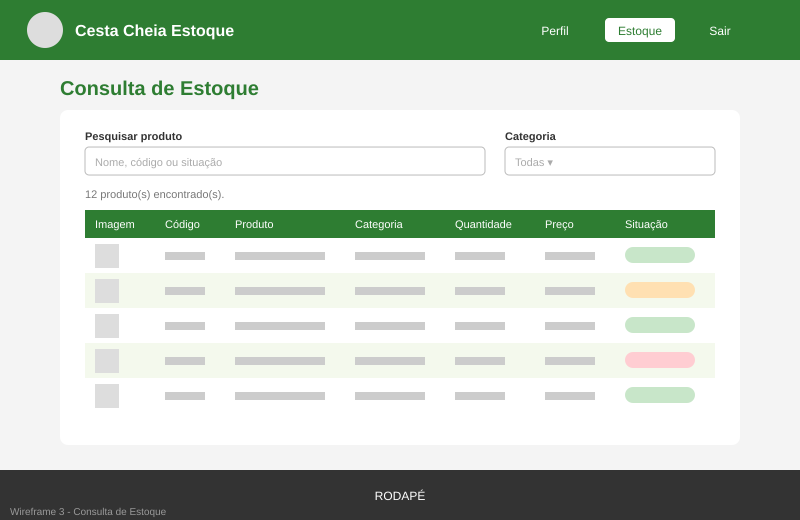
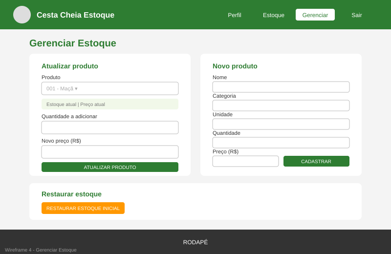

# Cesta Cheia Estoque - Sistema Interno

Projeto da **Situação de Aprendizagem 02** - interface de um sistema web interno para o Mercado Cesta Cheia, com login e cadastro de usuários, perfil, consulta de estoque com campo de pesquisa e gerenciamento simples do estoque.

- **Aluno:** Pedro Henrique de Sousa Martins
- **Turma:** A1129-N-D.S.M.-312-20262

## Site publicado

https://dontgoat.github.io/mercado-estoque/

## Acesso de teste

| Campo  | Valor                  |
|--------|------------------------|
| E-mail | pedro@cestacheia.com   |
| Senha  | 123456                 |

Também é possível criar uma conta nova pelo link **Cadastre-se** na tela de login.

## Páginas

- `index.html` - Tela de login e cadastro de usuário, com validação dos campos e mensagens de erro ou sucesso.
- `perfil.html` - Perfil do usuário logado com foto, dados do funcionário e formulário para atualizar telefone, turno e senha.
- `estoque.html` - Tabela de produtos em estoque com pesquisa por texto e filtro por categoria.
- `gerenciar.html` - Gerenciamento do estoque: adicionar quantidade, mudar o preço e cadastrar novos produtos.

As páginas internas só abrem depois do login. O link **Sair** volta para o login e encerra a sessão.

## Como os dados são salvos

O sistema não tem servidor, então os dados ficam salvos no próprio navegador com `localStorage` (usando `JSON.stringify` e `JSON.parse`):

- `usuarios` - contas criadas pelo cadastro.
- `produtos` - lista do estoque. Na primeira visita ela começa com os 12 produtos iniciais.

A situação de cada produto é calculada pela quantidade: **0** é "Esgotado", **até 15** é "Estoque baixo" e **acima de 15** é "Em estoque". Na página Gerenciar existe o botão **Restaurar estoque inicial** para voltar aos dados do começo.

Como é um protótipo de interface, as senhas ficam guardadas apenas no navegador e servem só para simular o acesso.

## Protótipo

Antes da programação, as telas foram planejadas em wireframes (pasta `prototipo/`).

| Login | Perfil |
|-------|--------|
|  |  |

| Estoque | Gerenciar |
|---------|-----------|
|  |  |

## Identidade visual

- **Verde (#2e7d32):** cor principal, a mesma do site do Mercado Cesta Cheia (SA01).
- **Laranja (#ff9800):** cor de destaque para botões secundários e foco dos campos.
- **Situação do estoque:** verde para "Em estoque", laranja para "Estoque baixo" e vermelho para "Esgotado".
- **Fonte:** Arial, simples e fácil de ler em qualquer tela.

## Imagens otimizadas

| Imagem | Formato | Tamanho | Por quê |
|--------|---------|---------|---------|
| Logo e produtos | SVG | menos de 0,5 KB cada | Desenho vetorial, fica nítido em qualquer tamanho e quase não pesa. |
| Foto de perfil | WebP 240x240 | 1,9 KB | Formato moderno e leve. A imagem original em PNG 960x960 tinha 8 KB e foi reduzida para o dobro do tamanho exibido (120x120), ficando nítida em telas de alta resolução. |

Todas as imagens têm `width`, `height` e texto alternativo (`alt`).

## Usabilidade e acessibilidade

- Todo campo tem `label` ligado pelo `for`.
- Campos agrupados com `fieldset` e `legend` no perfil.
- `autocomplete` nos campos de e-mail, senha e telefone.
- Mensagens com `aria-live` para leitores de tela.
- Tabela com `caption` e `th scope="col"`.
- Destaque laranja no campo em foco.

## Responsividade

Feita com CSS puro: `flexbox`, `grid` e `@media (max-width: 600px)`. No celular o menu e os filtros ficam um embaixo do outro, e a tabela ganha rolagem horizontal.

## Estrutura de pastas

```
mercado-estoque/
├── index.html
├── perfil.html
├── estoque.html
├── gerenciar.html
├── README.md
├── css/
│   └── style.css
├── js/
│   ├── login.js
│   ├── perfil.js
│   ├── produtos.js
│   ├── estoque.js
│   └── gerenciar.js
├── img/
│   ├── logo.svg
│   ├── avatar.webp
│   └── produtos/
│       └── (imagens dos produtos em SVG)
└── prototipo/
    ├── 1-login.svg
    ├── 2-perfil.svg
    ├── 3-estoque.svg
    └── 4-gerenciar.svg
```

## Tecnologias

- HTML5 semântico (`header`, `nav`, `main`, `section`, `form`, `fieldset`, `table`, `footer`)
- CSS3 externo (`css/style.css`)
- JavaScript (validação dos formulários, cadastro e login, pesquisa na tabela e gerenciamento do estoque)
- Web Storage (`localStorage` e `sessionStorage`)
